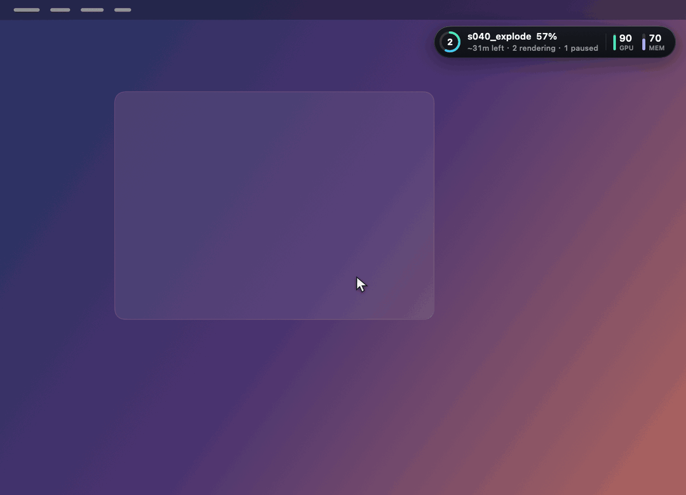

<div align="center">


# RenderDock

**Jedes Rendering auf dem Mac, in einer schwebenden Kapsel.**

[English](../../README.md) · [简体中文](README.zh-CN.md) · [繁體中文](README.zh-TW.md) · [日本語](README.ja.md) · [한국어](README.ko.md) · [Español](README.es.md) · [Français](README.fr.md) · **Deutsch** · [Português](README.pt-BR.md) · [Русский](README.ru.md)




<sub>Die Oberfläche oben wird von der App selbst im Demo-Modus gezeichnet. Jobs, Zahlen und Mauszeiger folgen einem Drehbuch; der Hintergrund ist ein nachgestellter Schreibtisch.</sub>

</div>

---

RenderDock ist eine kleine native macOS-App für alle, die Renderings aus Skripten und Terminals starten. Sie findet jeden Blender-Job, der ohne Oberfläche (headless) auf dem Rechner läuft, zeigt, wie weit jeder ist, und behält die Hardware im Blick, die die Arbeit erledigt. Eine Einrichtung ist nicht nötig, und die Jobs selbst werden nie angefasst.

## Warum

Ein Rendering, das aus einem Shell-Skript gestartet wird, hat kein Fenster. Am Ende ruft man `ps` auf, zählt Dateien im Ausgabeordner und fragt sich, ob der Mac vor einer Stunde in den Ruhezustand gegangen ist. RenderDock bringt all das an einen Ort, der immer sichtbar ist und nie im Weg steht.

## Was die App bietet

<table>
<tr>
<td width="50%" valign="top">

**Eine Kapsel, die überall Platz findet**

Sie lässt sich auf jeden Bildschirm ziehen. Sie rastet an Kanten, in Ecken und in der Mitte des oberen oder unteren Rands ein und merkt sich, wo sie zuletzt lag. Sie schwebt über Vollbild-Apps und kommt beim Wechsel zwischen Spaces mit.


**Ein Klick für den ganzen Überblick**

- Jede Job-Kette als Karte: Titel, Projekt, Skript, verstrichene Zeit
- Ein Segmentbalken für Warteschlangen mit mehreren Shots: fertig (Done), rendert (Rendering), pausiert (Paused), als Nächstes (Up next)
- Für den laufenden Shot: Vorschaubild des letzten Frames, Frame-Anzahl, Sekunden pro Frame, Restzeit, CPU-Kerne und Arbeitsspeicher
- Zustände, die unterschieden werden: läuft (Running), pausiert (`SIGSTOP`), hängt (Stalled), wartet (Queued)

**Der Rechner auf einen Blick**

CPU, GPU-Auslastung und GPU-Speicher, Arbeitsspeicher und Speicherdruck, SoC-Temperatur, Swap, freier Speicherplatz, Stromquelle und ob etwas den Mac wach hält.

</td>
<td width="50%" valign="top">


</td>
</tr>
</table>

Außerdem enthalten: ein Menüleisten-Symbol mit Fortschrittsring, ein optionaler Schalter **Beim Rendern wach bleiben** (Keep Awake While Rendering) und **Bei der Anmeldung starten** (Launch at Login).

## Schnellstart

Voraussetzungen: macOS 14 oder neuer und die Swift-6-Toolchain (Xcode 16+ oder nur die Command Line Tools: `xcode-select --install`).

```bash
git clone https://github.com/JarnoNiu/RenderDock.git
cd RenderDock
zsh scripts/install.sh
```

Das baut die App, kopiert sie nach `/Applications/RenderDock.app` und startet sie. Kein Admin-Passwort, keine Abhängigkeiten zum Herunterladen. Mit `--login` wird zusätzlich der Start bei der Anmeldung aktiviert.

Gerade läuft kein Rendering? Mit erfundenen Jobs lässt sich die App trotzdem ansehen:

```bash
open -n /Applications/RenderDock.app --args --demo
```

Oder zusehen, wie sie einen echten Prozess aufgreift, ganz ohne Blender und ohne GPU:

```bash
zsh scripts/fake-render.sh 60 1
```

> Einen fertigen Download gibt es noch nicht. Die App ist nicht notarisiert, und ein unsignierter Download macht mehr Ärger als ein Build von 30 Sekunden. Signierte Releases und ein Homebrew-Cask stehen auf der Roadmap.

## Wie die App Renderings findet

RenderDock liest die Prozesstabelle und die Ausgabeordner. Die App klinkt sich nicht in Blender ein, und an den Skripten muss nichts geändert werden.

| Was die App sieht | Was sie anzeigt |
|---|---|
| Ein Blender-Prozess, der mit `-b` / `--background` gestartet wurde | Ein **Shot** |
| Das äußerste Skript darüber im Prozessbaum (`zsh render_all.sh`, `python queue.py`, …) | Eine **Job-Kette**: eine Karte. Der Titel ist die erste Kommentarzeile dieses Skripts |
| `scene:shot`-Argumente in der Kommandozeile eines Warteschlangen-Skripts | Die **Warteschlange**: welche Shots fertig sind, gerade rendern oder als Nächstes kommen |
| Ein in `caffeinate` verpacktes Skript, das noch keinen Render-Prozess hat | **Wartet** |
| Ein mit `kill -STOP` angehaltener Prozess | **Pausiert** |
| Kein neuer Frame seit dem 10-Fachen der üblichen Frame-Zeit (mindestens 5 Minuten) | **Hängt** |
| Bilddateien im Ausgabeordner, nach Frame-Nummer dedupliziert | **Fertige Frames**, Sekunden pro Frame, Vorschaubild des letzten Frames |

Der Ausgabeordner stammt aus Blenders eigenem `-o` / `--render-output` (einschließlich `//`-Pfaden relativ zur `.blend`-Datei) oder aus einem Skript-Argument `--out ORDNER` nach `--`.

### Woher die Prozentzahl kommt

RenderDock zeigt nur dann eine Prozentzahl an, wenn die Gesamtzahl bekannt ist. Geraten wird nicht.

| Quelle | Anzeige |
|---|---|
| `render-progress.json` im Ausgabeordner (siehe unten) | exakt: `412/720 frames · 57%` und Restzeit |
| Ein Frame-Bereich in der Kommandozeile: `-s 1 -e 250 -a` oder `-f 1..250` | exakt |
| Ein älterer Clip mit gleichem Namen neben dem Ausgabeordner | Schätzung, mit `≈` markiert. Wird verworfen, sobald die Frame-Anzahl darüber liegt |
| Nichts davon | nur Frame-Anzahl und Sekunden pro Frame, mit unbestimmtem Fortschrittsbalken |

```bash
# exakter Fortschritt, ohne Einrichtung
blender -b shot_010.blend -o //render/frame_#### -s 1 -e 250 -a
```

### `render-progress.json`: exakter Fortschritt für jede Pipeline

Wenn der Frame-Bereich in der `.blend`-Datei steckt oder das Skript die Frames selbst rendert, genügt es, nach jedem Frame eine kleine Datei in den Ausgabeordner zu schreiben:

```json
{"done": 12, "total": 720}
```

```python
# in einem Blender-Python-Skript
(out_dir / "render-progress.json").write_text(json.dumps({"done": i + 1, "total": len(frames)}))
```

Alles, was eine Datei schreiben kann, kann auf diese Weise Fortschritt melden, nicht nur Blender.

## Was die App nicht tut

- Sie greift **nur lesend** zu. Sie sendet keine Signale, schreibt nichts außerhalb der eigenen Einstellungen und baut keine Netzwerkverbindungen auf.
- Version 0.1 hat keine Buttons für Pausieren, Fortsetzen oder Stoppen. Warteschlangen-Skripte verwalten `STOP`/`CONT` oft selbst, und zwei Hände am selben Schalter sind keine gute Idee.
- Wenn weder der Ausgabeordner noch der Frame-Bereich in der Kommandozeile stehen, erscheint der Job trotzdem, mit CPU, Arbeitsspeicher und verstrichener Zeit, aber ohne Frames.
- Die SoC-Temperatur wird über IOHID-Sensoren gelesen, eine private Schnittstelle, die auf Apple Silicon verfügbar ist. Auf Intel-Macs oder nach einem Systemupdate, das die Sensoren verschiebt, zeigt die Kachel `–`. Lüfterdrehzahl und Leistungsaufnahme werden nicht ausgelesen.
- Gebaut und getestet unter macOS 26 auf einem M5 Max. Die App kompiliert für macOS 14, aber 14 und 15 sowie Intel-Macs sind ungetestet. Erfahrungsberichte sind willkommen.
- Sprachen der Oberfläche: Englisch und vereinfachtes Chinesisch (richtet sich nach der Systemsprache; mit `--lang en` oder `--lang zh` lässt sich eine Sprache erzwingen).

## Roadmap

Die vollständige TODO-Liste mit Zeitplan steht in **[ROADMAP.md](../../ROADMAP.md)**.

Kurz gefasst (Pläne, keine Versprechen):

- Exakter Fortschritt von Haus aus: ein Wrapper oder Add-on, das Blenders eigene Frame-Ausgabe liest
- Mehr als Blender: ffmpeg-Encodes, ComfyUI, After Effects und ein kleines Adapterformat für alles andere
- Benachrichtigungen, wenn ein Job fertig wird, hängt oder fehlschlägt, auf dem Mac und auf dem Smartphone
- Eine lokale API, damit ein Schreibtisch-Display, eine Statusleuchte oder eine Stream-Deck-Taste denselben Fortschritt anzeigen kann
- Verlauf: wie lange Shots tatsächlich gedauert haben, und daraus bessere Restzeit-Schätzungen
- Optionale Steuerung: pausieren, fortsetzen, Priorität senken
- Signierte und notarisierte Releases, Homebrew, weitere Oberflächensprachen

## Entwicklung

| Befehl | Was er tut |
|---|---|
| `zsh scripts/build-app.sh` | Baut `build/RenderDock.app` (ad hoc signiert; das Symbol zeichnet die App selbst) |
| `zsh scripts/install.sh [--login]` | Baut, installiert nach `/Applications`, startet neu |
| `.build/release/RenderDock --dump` | Gibt erkannte Jobs und Messwerte als Text aus, ohne Oberfläche |
| `.build/release/RenderDock --snapshot ORDNER [--demo]` | Zeichnet Kapsel und Panel als PNG |
| `zsh scripts/make-demo.sh` | Erzeugt die Screenshots und das GIF in `assets/` neu |
| `zsh scripts/fake-render.sh [Frames] [Sek./Frame]` | Ein Dummy-Rendering zum Testen der Erkennung |
| `python3 scripts/verify-interactions.py <Binary>` | Schickt Klicks und Ziehbewegungen an eine mit `--debug` gestartete Instanz und prüft Aufklappen, Einklappen und Einrasten (12 Prüfungen) |

Der Code ist schlichtes Swift und SwiftUI, mit AppKit für das Fenster: rund 3000 Zeilen, keine Pakete. Siehe [CONTRIBUTING.md](../../CONTRIBUTING.md).

## Danksagung

RenderDock teilt keinen Code mit diesen Projekten, aber sie haben gezeigt, was ohne `sudo` möglich ist: [Stats](https://github.com/exelban/stats) und [macmon](https://github.com/vladkens/macmon) beim Auslesen von GPU- und Sensordaten sowie [boring.notch](https://github.com/TheBoredTeam/boring.notch) dabei, eine kleine, stets präsente Oberfläche auf dem Mac heimisch wirken zu lassen.

Ein Projekt mit ähnlichem Ziel: [Blender Render Monitor](https://github.com/DUBSON0/blender-render-monitor) listet ebenfalls Blender-Renderings auf dem Mac auf und bietet bereits Pausieren, Fortsetzen und eine Warteschlange. Den Fortschritt bezieht es aus einem Blender-Hook-Skript oder einer Logdatei. RenderDock 0.1 entstand, ohne dass dieses Projekt bekannt war; die beiden teilen keinen Code.

## Lizenz

[MIT](../../LICENSE)
