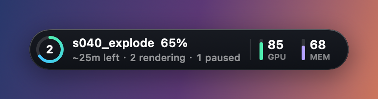

<div align="center">


# RenderDock

**Tous les rendus de votre Mac, dans une seule capsule flottante.**

[English](../../README.md) · [简体中文](README.zh-CN.md) · [繁體中文](README.zh-TW.md) · [日本語](README.ja.md) · [한국어](README.ko.md) · [Español](README.es.md) · **Français** · [Deutsch](README.de.md) · [Português](README.pt-BR.md) · [Русский](README.ru.md)


<sub>L'interface ci-dessus est dessinée par l'application elle-même en mode démo. Les tâches, les chiffres et le pointeur sont scénarisés ; l'arrière-plan est un bureau factice.</sub>

</div>

---

RenderDock est une petite application macOS native pour celles et ceux qui lancent leurs rendus depuis des scripts et des terminaux. Elle repère toutes les tâches Blender sans interface en cours sur la machine, indique où en est chacune et garde un œil sur le matériel qui fait le travail. Elle ne demande aucune configuration et ne touche jamais à vos tâches.

## Pourquoi

Un rendu lancé depuis un script shell n'a pas de fenêtre. On finit par exécuter `ps`, compter les fichiers dans un dossier de sortie et se demander si le Mac ne s'est pas mis en veille il y a une heure. RenderDock rassemble tout cela en un seul endroit, toujours à l'écran et jamais gênant.

## Ce que vous obtenez

<table>
<tr>
<td width="50%" valign="top">

**Une capsule qui se pose n'importe où**

Faites-la glisser sur n'importe quel écran. Elle s'aimante aux bords, aux coins et au centre du bord supérieur ou inférieur, et retient l'endroit où vous l'avez laissée. Elle flotte au-dessus des applications en plein écran et vous suit d'un Space à l'autre.



**Un clic pour tout voir**

- Chaque chaîne de tâches sous forme de carte : titre, projet, script, temps écoulé
- Une barre segmentée pour les files d'attente de plusieurs plans : terminé (Done), rendu en cours (Rendering), en pause (Paused), à suivre (Up next)
- Pour le plan en cours : une vignette de la dernière image, le nombre d'images, les secondes par image, le temps restant, les cœurs CPU et la mémoire
- Les états distingués : en cours (Running), en pause (`SIGSTOP`), bloqué (Stalled), en attente (Queued)

**La machine, d'un coup d'œil**

CPU, utilisation et mémoire du GPU, mémoire et pression mémoire, température du SoC, swap, espace disque libre, source d'alimentation, et si quelque chose maintient le Mac éveillé.

</td>
<td width="50%" valign="top">


</td>
</tr>
</table>

Également inclus : un élément de barre des menus avec un anneau de progression, un interrupteur facultatif **Empêcher la veille pendant le rendu** (Keep Awake While Rendering) et **Ouvrir à la connexion** (Launch at Login).

Nouveautés de la version 0.2 : une progression exacte pour n'importe quel rendu grâce à [`renderdock run`](../EXACT-PROGRESS.md), des [notifications](../NOTIFICATIONS.md) sur le Mac et sur votre téléphone quand une tâche se termine, échoue ou se bloque, et une [API locale](../API.md) pour que d'autres afficheurs puissent montrer la même progression. Ces trois documents n'existent pour l'instant qu'en anglais.

## Démarrage rapide

Prérequis : macOS 14 ou version ultérieure, et la chaîne d'outils Swift 6 (Xcode 16 ou version ultérieure, ou simplement les Command Line Tools : `xcode-select --install`).

```bash
git clone https://github.com/JarnoNiu/RenderDock.git
cd RenderDock
zsh scripts/install.sh
```

Cette commande compile l'application, la copie dans `/Applications/RenderDock.app` et la lance. Pas de mot de passe administrateur, aucune dépendance à télécharger. Ajoutez `--login` pour activer aussi l'ouverture à la connexion.

Aucun rendu en cours ? Regardez ce que cela donne avec des tâches fictives :

```bash
open -n /Applications/RenderDock.app --args --demo
```

Ou regardez-la détecter un vrai processus, sans Blender ni GPU :

```bash
zsh scripts/fake-render.sh 60 1
```

> Il n'existe pas encore de version précompilée à télécharger. L'application n'est pas notarisée, et un téléchargement non signé cause plus de tracas qu'une compilation de 30 secondes. Des versions signées et un cask Homebrew figurent sur la feuille de route.

## Comment RenderDock trouve vos rendus

RenderDock lit la table des processus et les dossiers de sortie. L'application ne se greffe pas sur Blender, et vous n'avez pas à modifier vos scripts.

| Ce qu'elle voit | Ce qu'elle affiche |
|---|---|
| Un processus Blender lancé avec `-b` / `--background` | Un **plan** |
| Le script le plus externe au-dessus de lui dans l'arbre des processus (`zsh render_all.sh`, `python queue.py`, …) | Une **chaîne de tâches** : une carte. Le titre est la première ligne de commentaire de ce script |
| Des arguments `scene:shot` sur la ligne de commande d'un script de file d'attente | La **file d'attente** : quels plans sont terminés, en cours de rendu ou à suivre |
| Un script encapsulé dans `caffeinate`, sans processus de rendu pour l'instant | **En attente** |
| Un processus arrêté avec `kill -STOP` | **En pause** |
| Aucune nouvelle image depuis 10 fois le temps habituel par image (5 minutes au minimum) | **Bloqué** |
| Les fichiers image du dossier de sortie, dédoublonnés par numéro d'image | **Images terminées**, secondes par image, vignette de la dernière image |

Le dossier de sortie vient des options `-o` / `--render-output` de Blender (y compris les chemins `//` relatifs au `.blend`), ou d'un argument de script `--out DOSSIER` placé après `--`. Les étapes de votre propre pipeline qui ne sont pas un simple rendu Blender peuvent être décrites dans un petit [fichier de règles](../ADAPTERS.md).

### D'où vient le pourcentage

RenderDock n'affiche un pourcentage que si le total est connu. L'application ne devine pas.

| Source | Affichage |
|---|---|
| `render-progress.json` dans le dossier de sortie (voir ci-dessous) | exact : `412/720 frames · 57%` et le temps restant |
| Une plage d'images sur la ligne de commande : `-s 1 -e 250 -a`, ou `-f 1..250` | exact |
| Lancé avec `renderdock run --`, ou avec le hook Blender chargé | exact, même quand rien ne figure sur la ligne de commande. Distingue aussi une tâche terminée d'une tâche qui a échoué |
| Un ancien clip du même nom à côté du dossier de sortie | estimation, signalée par `≈`. Abandonnée dès que le nombre d'images la dépasse |
| Rien de tout cela | nombre d'images et secondes par image uniquement, avec une barre indéterminée |

```bash
# progression exacte, sans configuration
blender -b shot_010.blend -o //render/frame_#### -s 1 -e 250 -a
```

### `render-progress.json` : une progression exacte pour n'importe quel pipeline

Si votre plage d'images est définie dans le `.blend`, ou si votre script rend lui-même les images, écrivez un petit fichier dans le dossier de sortie après chaque image :

```json
{"done": 12, "total": 720}
```

```python
# dans un script Python Blender
(out_dir / "render-progress.json").write_text(json.dumps({"done": i + 1, "total": len(frames)}))
```

Tout ce qui peut écrire un fichier peut signaler sa progression de cette façon, pas seulement Blender.

## Ce que RenderDock ne fait pas

- L'application est en **lecture seule** : elle n'envoie aucun signal et n'écrit jamais dans vos dossiers de rendu. Elle n'établit aucune connexion réseau, sauf si vous ajoutez un canal de notification, et l'API locale facultative n'écoute que sur `127.0.0.1`.
- Il n'y a pas encore de boutons pause, reprise ou arrêt. Les scripts de file d'attente gèrent souvent `STOP`/`CONT` eux-mêmes, et deux mains sur le même interrupteur, c'est une mauvaise idée.
- Si ni le dossier de sortie ni la plage d'images ne figurent sur la ligne de commande, la tâche apparaît quand même, avec le CPU, la mémoire et le temps écoulé, mais sans les images.
- La température du SoC est lue sur les capteurs IOHID, une interface privée disponible sur les puces Apple. Sur les Mac Intel, ou après une mise à jour système qui déplace les capteurs, la tuile affiche `–`. La vitesse des ventilateurs et la puissance consommée ne sont pas lues.
- Compilée et testée sous macOS 26 avec un M5 Max. Elle compile pour macOS 14, mais les versions 14 et 15 ainsi que les Mac Intel n'ont pas été testés. Les retours sont les bienvenus.
- Langues de l'interface : anglais et chinois simplifié (elle suit la langue du système ; forcez-en une avec `--lang en` ou `--lang zh`).

## Feuille de route

La liste complète de ce qui reste à faire, avec un calendrier, se trouve dans **[ROADMAP.md](../../ROADMAP.md)**.

En bref (des projets, pas des promesses) :

- Au-delà de Blender : encodages ffmpeg et ComfyUI, avec une vraie progression
- Un historique : la durée réelle des plans, et de meilleures estimations du temps restant à partir de là
- Les premiers afficheurs matériels : un ruban LED en guise de barre de progression, une touche de Stream Deck, un petit écran à bouton rotatif
- Des contrôles facultatifs : pause, reprise, baisse de priorité
- Des versions signées et notarisées, Homebrew, davantage de langues d'interface

## Développement

| Commande | Ce qu'elle fait |
|---|---|
| `zsh scripts/build-app.sh` | Compile `build/RenderDock.app` (signature ad hoc ; l'icône est dessinée par l'application elle-même) |
| `zsh scripts/install.sh [--login]` | Compile, installe dans `/Applications`, relance |
| `swift run rd-checks` | Vérifie le cœur de l'application : parsing, événements, API, notifications (132 vérifications) |
| `.build/release/RenderDock --dump` | Affiche en texte les tâches détectées et les indicateurs, sans interface |
| `.build/release/RenderDock --snapshot DOSSIER [--demo]` | Génère la capsule et le panneau en PNG |
| `zsh scripts/make-demo.sh` | Régénère les captures d'écran et le GIF dans `assets/` |
| `zsh scripts/fake-render.sh [images] [s/image]` | Un faux rendu pour tester la détection |
| `python3 scripts/verify-interactions.py <binaire>` | Injecte des clics et des glissements dans une instance lancée avec `--debug` et vérifie le déploiement, le repli et l'aimantation (12 vérifications) |

Le code est du Swift et du SwiftUI tout simples, avec AppKit pour la fenêtre : environ 5 000 lignes, aucun paquet. Voir [CONTRIBUTING.md](../../CONTRIBUTING.md).

## Remerciements

RenderDock ne partage aucun code avec ces projets, mais ils ont montré ce qu'il est possible de faire sans `sudo` : [Stats](https://github.com/exelban/stats) et [macmon](https://github.com/vladkens/macmon) pour la lecture des données du GPU et des capteurs, et [boring.notch](https://github.com/TheBoredTeam/boring.notch) pour avoir fait en sorte qu'une petite interface toujours présente se sente chez elle sur un Mac.

Un projet au but similaire : [Blender Render Monitor](https://github.com/DUBSON0/blender-render-monitor) liste lui aussi les rendus Blender sur un Mac, et propose déjà la pause, la reprise et une file d'attente. Il obtient la progression à partir d'un script hook Blender ou d'un fichier journal. RenderDock 0.1 a été écrit sans en avoir connaissance ; les deux ne partagent aucun code.

## Licence

[MIT](../../LICENSE)
