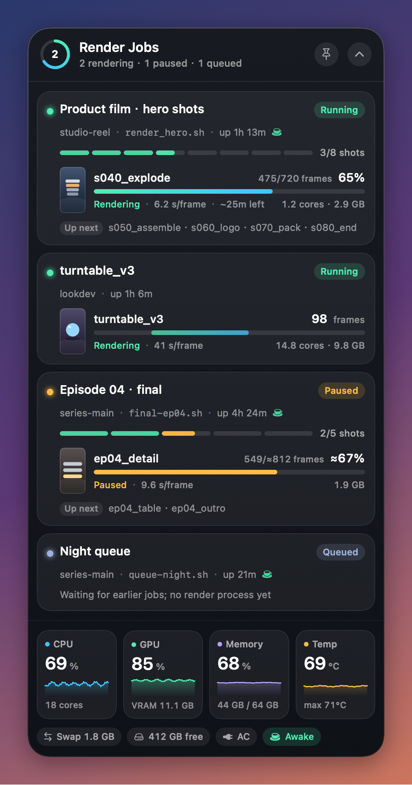

<div align="center">


# RenderDock

**Mac で動いているすべてのレンダリングを、ひとつのフローティングカプセルに。**

[English](../../README.md) · [简体中文](README.zh-CN.md) · [繁體中文](README.zh-TW.md) · **日本語** · [한국어](README.ko.md) · [Español](README.es.md) · [Français](README.fr.md) · [Deutsch](README.de.md) · [Português](README.pt-BR.md) · [Русский](README.ru.md)


<sub>上の UI は、アプリ自身がデモモードで描画したものです。ジョブ、数値、ポインタの動きはあらかじめ用意した台本どおりで、背景は模擬のデスクトップです。</sub>

</div>

---

RenderDock は、スクリプトやターミナルからレンダリングを実行する人のための、小さなネイティブ macOS アプリです。マシン上で動いているヘッドレスの Blender ジョブをすべて見つけ、それぞれがどこまで進んだかを表示し、処理を担うハードウェアの状態も見守ります。セットアップは不要で、ジョブには一切手を触れません。

## なぜ作ったのか

シェルスクリプトから起動したレンダリングにはウィンドウがありません。結局は `ps` を実行し、出力フォルダのファイルを数え、Mac が 1 時間前にスリープしてしまったのではと気にすることになります。RenderDock はそのすべてを 1 か所にまとめます。常に画面上にあり、それでいて邪魔になりません。

## できること

<table>
<tr>
<td width="50%" valign="top">

**どこにでも置けるカプセル**

好きなディスプレイにドラッグできます。画面の端、隅、上辺または下辺の中央にスナップし、置いた場所を覚えています。フルスクリーンアプリの上にも表示され、Spaces を切り替えてもついてきます。


**ワンクリックで全体を把握**

- ジョブチェーンごとに 1 枚のカード：タイトル、プロジェクト、スクリプト、経過時間
- 複数ショットのキューにはセグメントバー：完了（Done）、レンダリング中（Rendering）、一時停止（Paused）、次に実行（Up next）
- 進行中のショットについては、最新フレームのサムネイル、フレーム数、1 フレームあたりの秒数、残り時間、CPU コア数、メモリ
- 見分けられる状態：実行中（Running）、一時停止（`SIGSTOP`）、停滞（Stalled）、待機中（Queued）

**マシンの状態をひと目で**

CPU、GPU 使用率と GPU メモリ、メモリとメモリプレッシャー、SoC 温度、スワップ、ディスクの空き容量、電源、そして何かが Mac のスリープを防いでいるかどうかを表示します。

</td>
<td width="50%" valign="top">



</td>
</tr>
</table>

ほかにも、進捗リング付きのメニューバー項目、オプションの「**レンダリング中はスリープさせない**（Keep Awake While Rendering）」スイッチ、「**ログイン時に起動**（Launch at Login）」があります。

## クイックスタート

必要なもの：macOS 14 以降と、Swift 6 ツールチェーン（Xcode 16 以降、または Command Line Tools のみ：`xcode-select --install`）。

```bash
git clone https://github.com/JarnoNiu/RenderDock.git
cd RenderDock
zsh scripts/install.sh
```

これでアプリがビルドされ、`/Applications/RenderDock.app` にコピーされて起動します。管理者パスワードは不要で、ダウンロードする依存関係もありません。`--login` を付けると、ログイン時の起動も有効になります。

実行中のレンダリングがないときは、架空のジョブで様子を確認できます。

```bash
open -n /Applications/RenderDock.app --args --demo
```

あるいは、Blender も GPU も使わずに、実際のプロセスを検出するところを確認できます。

```bash
zsh scripts/fake-render.sh 60 1
```

> ビルド済みのダウンロードはまだありません。アプリは公証（notarize）されておらず、署名のないものをダウンロードして使うほうが、30 秒のビルドよりも手間がかかります。署名付きリリースと Homebrew cask はロードマップに入っています。

## レンダリングを見つける仕組み

RenderDock が読むのは、プロセステーブルと出力フォルダです。Blender にフックすることはなく、スクリプトを書き換える必要もありません。

| RenderDock が見るもの | 表示されるもの |
|---|---|
| `-b` / `--background` 付きで起動された Blender プロセス | **ショット** |
| プロセスツリーでその上にある、いちばん外側のスクリプト（`zsh render_all.sh`、`python queue.py` など） | **ジョブチェーン**：1 枚のカード。タイトルはそのスクリプトの最初のコメント行です |
| キュースクリプトのコマンドラインにある `scene:shot` 引数 | **キュー**：どのショットが完了し、どれがレンダリング中で、どれが次か |
| `caffeinate` でラップされていて、まだレンダリングプロセスがないスクリプト | **待機中** |
| `kill -STOP` で止められたプロセス | **一時停止** |
| 通常のフレーム時間の 10 倍（最低 5 分）にわたって新しいフレームが出ていない | **停滞** |
| 出力フォルダ内の画像ファイル（フレーム番号で重複を除外） | **完了フレーム数**、1 フレームあたりの秒数、最新フレームのサムネイル |

出力フォルダは、Blender 自身の `-o` / `--render-output`（`.blend` からの相対パスを表す `//` も含みます）、または `--` の後ろに置いたスクリプト引数 `--out DIR` から取得します。

### パーセント表示の根拠

RenderDock がパーセントを表示するのは、総数がわかっているときだけです。推測はしません。

| 情報源 | 表示 |
|---|---|
| 出力フォルダ内の `render-progress.json`（後述） | 正確な値：`412/720 frames · 57%` と残り時間 |
| コマンドラインで指定したフレーム範囲：`-s 1 -e 250 -a` または `-f 1..250` | 正確な値 |
| 出力フォルダの隣にある同名の古いクリップ | 推定値。`≈` を付けて表示し、フレーム数がそれを超えた時点で破棄します |
| 上記のいずれもなし | フレーム数と 1 フレームあたりの秒数のみ。バーは不確定表示になります |

```bash
# セットアップなしで正確な進捗
blender -b shot_010.blend -o //render/frame_#### -s 1 -e 250 -a
```

### `render-progress.json`：どんなパイプラインでも正確な進捗を

フレーム範囲が `.blend` の中にある場合や、スクリプトが自分でフレームをレンダリングする場合は、1 フレーム終わるごとに小さなファイルを 1 つ出力フォルダに書き込んでください。

```json
{"done": 12, "total": 720}
```

```python
# Blender の Python スクリプト内で
(out_dir / "render-progress.json").write_text(json.dumps({"done": i + 1, "total": len(frames)}))
```

ファイルを書き込めるものであれば、Blender に限らず何でも、この方法で進捗を報告できます。

## やらないこと

- **読み取り専用**です。シグナルは送らず、自身の環境設定以外には何も書き込まず、ネットワーク接続も行いません。
- バージョン 0.1 には、一時停止、再開、停止のボタンがありません。キュースクリプトが自分で `STOP`/`CONT` を管理していることが多く、同じスイッチに 2 つの手がかかるのは良い考えではありません。
- 出力フォルダもフレーム範囲もコマンドラインにない場合でも、ジョブは表示されます。CPU、メモリ、経過時間は表示されますが、フレームは表示されません。
- SoC 温度は IOHID センサーから読み取ります。これは Apple シリコンで使える非公開インターフェイスです。Intel Mac の場合や、システムアップデートでセンサーが移動した場合、このタイルには `–` と表示されます。ファンの回転数と消費電力は読み取りません。
- macOS 26 と M5 Max でビルドとテストを行っています。macOS 14 向けにコンパイルはできますが、14 と 15、および Intel Mac ではテストしていません。報告を歓迎します。
- UI の言語：英語と簡体字中国語（システムの言語に従います。`--lang en` または `--lang zh` で固定できます）。

## ロードマップ

タイムライン付きの完全な TODO リストは **[ROADMAP.md](../../ROADMAP.md)** にあります。

要点は次のとおりです（計画であり、約束ではありません）。

- 設定なしで正確な進捗：Blender 自身のフレーム出力を読み取るラッパーまたはアドオン
- Blender 以外にも対応：ffmpeg のエンコード、ComfyUI、After Effects、そのほかのツール向けの小さなアダプタ形式
- ジョブが完了、停滞、失敗したときの通知（Mac とスマートフォンの両方）
- ローカル API：卓上ディスプレイ、ステータスライト、Stream Deck のキーにも同じ進捗を表示できるように
- 履歴：ショットに実際にかかった時間と、それをもとにした、より正確な残り時間の見積もり
- オプションの操作：一時停止、再開、優先度の引き下げ
- 署名・公証済みのリリース、Homebrew、UI 言語の追加

## 開発

| コマンド | 内容 |
|---|---|
| `zsh scripts/build-app.sh` | `build/RenderDock.app` をビルドします（アドホック署名。アイコンはアプリ自身が描画します） |
| `zsh scripts/install.sh [--login]` | ビルドして `/Applications` にインストールし、再起動します |
| `.build/release/RenderDock --dump` | 検出したジョブと指標を、UI なしでテキスト出力します |
| `.build/release/RenderDock --snapshot DIR [--demo]` | カプセルとパネルを PNG に描画します |
| `zsh scripts/make-demo.sh` | `assets/` のスクリーンショットと GIF を再生成します |
| `zsh scripts/fake-render.sh [フレーム数] [秒/フレーム]` | 検出のテストに使うダミーのレンダリングです |
| `python3 scripts/verify-interactions.py <バイナリ>` | `--debug` 付きで起動したインスタンスにクリックとドラッグを注入し、展開、折りたたみ、スナップを確認します（12 項目のチェック） |

コードは素の Swift と SwiftUI で、ウィンドウには AppKit を使っています。約 3,000 行で、パッケージは使っていません。詳しくは [CONTRIBUTING.md](../../CONTRIBUTING.md) を参照してください。

## 謝辞

RenderDock は以下のプロジェクトとコードを共有していませんが、`sudo` なしで何ができるかはこれらが示してくれました。GPU とセンサーのデータの読み取りでは [Stats](https://github.com/exelban/stats) と [macmon](https://github.com/vladkens/macmon)、常にそこにある小さな UI を Mac になじませる点では [boring.notch](https://github.com/TheBoredTeam/boring.notch) です。

似た目的のプロジェクトとして、[Blender Render Monitor](https://github.com/DUBSON0/blender-render-monitor) があります。こちらも Mac 上の Blender レンダリングを一覧表示し、一時停止、再開、キューをすでに備えています。進捗は Blender のフックスクリプトまたはログファイルから取得します。RenderDock 0.1 はこのプロジェクトを知らずに書かれたもので、両者はコードを共有していません。

## ライセンス

[MIT](../../LICENSE)
