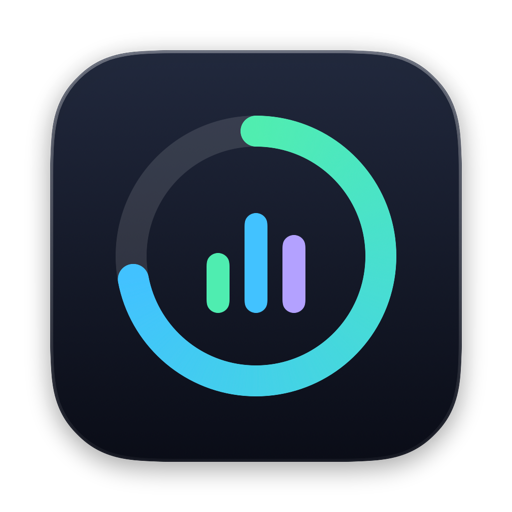

<div align="center">



# RenderDock

**Todos os renders do seu Mac, em uma cápsula flutuante.**

[English](../../README.md) · [简体中文](README.zh-CN.md) · [繁體中文](README.zh-TW.md) · [日本語](README.ja.md) · [한국어](README.ko.md) · [Español](README.es.md) · [Français](README.fr.md) · [Deutsch](README.de.md) · **Português** · [Русский](README.ru.md)


<sub>A interface acima é desenhada pelo próprio app em modo de demonstração. As tarefas, os números e o ponteiro seguem um roteiro; o fundo é uma área de trabalho simulada.</sub>

</div>

---

O RenderDock é um pequeno app nativo de macOS para quem inicia renders a partir de scripts e terminais. Ele encontra todas as tarefas do Blender sem interface em execução na máquina, mostra em que ponto cada uma está e fica de olho no hardware que faz o trabalho. Não precisa de configuração e apenas observa: tudo o que vai além disso é um interruptor que fica desligado até você ligá-lo.

## Por quê

Um render iniciado por um script de shell não tem janela. Você acaba rodando `ps`, contando arquivos em uma pasta de saída e se perguntando se o Mac entrou em repouso há uma hora. O RenderDock reúne tudo isso em um só lugar, que está sempre na tela e nunca atrapalha.

## O que ele oferece

<table>
<tr>
<td width="50%" valign="top">

**Uma cápsula que fica em qualquer lugar**

Arraste-a para qualquer tela. Ela se encaixa nas bordas, nos cantos e no centro da borda superior ou inferior, e lembra onde você a deixou. Flutua sobre apps em tela cheia e acompanha você de um Space a outro.


**Um clique para ver tudo**

- Cada cadeia de tarefas em um cartão: título, projeto, script, tempo decorrido
- Uma barra de segmentos para filas com vários shots: concluído (Done), renderizando (Rendering), pausado (Paused), a seguir (Up next)
- Para o shot em andamento: miniatura do último quadro, número de quadros, segundos por quadro, tempo restante, núcleos de CPU e memória
- Estados que ele distingue: em execução (Running), pausado (`SIGSTOP`), travado (Stalled), na fila (Queued)

**A máquina, de relance**

CPU, uso de GPU e memória de GPU, memória e pressão de memória, temperatura do SoC, swap, espaço livre em disco, fonte de energia e se algo está mantendo o Mac acordado.

</td>
<td width="50%" valign="top">


</td>
</tr>
</table>

Também inclui: um item na barra de menus com um anel de progresso, uma opção **Manter ativo durante o render** (Keep Awake While Rendering) e **Abrir ao iniciar sessão** (Launch at Login).

Novidades da versão 0.2: progresso exato para qualquer render com [`renderdock run`](../EXACT-PROGRESS.md), [notificações](../NOTIFICATIONS.md) no Mac e no celular quando uma tarefa termina, falha ou trava, e uma [API local](../API.md) para que outros displays mostrem o mesmo progresso. Esses três documentos estão, por enquanto, apenas em inglês.

Novidades da versão 0.3: um [histórico](../HISTORY.md) com estimativas de tempo restante para uma fila inteira; as [sessões de agentes de programação](../AGENT-TASKS.md) ao lado dos seus renders; progresso real para [codificações com ffmpeg](../EXACT-PROGRESS.md#ffmpeg-from-03), e a fila do [ComfyUI](../COMFYUI.md). Há mais coisas que ficam desligadas até você ligá-las: [responder ao pedido de permissão de um agente](../ANSWERING-AGENTS.md) pelo painel, um [pequeno display Bluetooth para a mesa](../DEVICES.md) com [firmware aberto](../../firmware/desk-display/README.md) para uma placa, uma [entrada para outros programas](../AGENT-ENTRY.md), para que qualquer script ou agente possa enviar um aviso, informar o progresso ou fazer uma pergunta a você, e [MQTT](../MQTT.md) para o Home Assistant. Dois [exemplos](../../examples) usam a API local: uma fita de LED como barra de progresso e uma tecla do Stream Deck. Esses documentos estão, por enquanto, apenas em inglês.

Novidades da versão 0.4: o RenderDock em [tema claro, como parte do notch e como widget da área de trabalho](../LOOKS.md); a velocidade dos ventiladores, a potência consumida pela máquina e a [energia gasta em cada shot](../HISTORY.md); uma visão ampliada de um shot, com um controle deslizante para percorrer os quadros já renderizados; as sessões do agente do Google (o app Gemini, o Antigravity) ao lado das do Claude Code, do Codex e do Hermes. Desligados até você ligar: a [API pela rede local](../API.md#from-the-local-network-04-off-by-default), protegida por um token; o [display de mesa por Wi-Fi](../DEVICES.md#over-wi-fi-where-bluetooth-does-not-reach-04) onde o Bluetooth não alcança, agora com uma página para os renders, uma para os agentes e uma para o Mac; a entrada para outros programas como [servidor MCP](../AGENT-ENTRY.md); e, pela primeira vez, [pôr a mão em um render](../CONTROLS.md): pausar e retomar, tirá-lo do caminho, uma tarefa por vez, pausar na bateria ou quando o Mac esquenta. Esses documentos estão, por enquanto, apenas em inglês.

## Início rápido

Requisitos: macOS 14 ou posterior e a toolchain do Swift 6 (Xcode 16+ ou apenas as Command Line Tools: `xcode-select --install`).

```bash
git clone https://github.com/JarnoNiu/RenderDock.git
cd RenderDock
zsh scripts/install.sh
```

Isso compila o app, copia para `/Applications/RenderDock.app` e o abre. Sem senha de administrador, sem dependências para baixar. Adicione `--login` para ativar também a abertura ao iniciar sessão.

Nenhum render rodando? Veja como ele fica com tarefas fictícias:

```bash
open -n /Applications/RenderDock.app --args --demo
```

Ou veja-o detectar um processo real, sem Blender e sem GPU envolvidos:

```bash
zsh scripts/fake-render.sh 60 1
```

> Ainda não há um download pré-compilado. O app não é notarizado, e um download não assinado dá mais trabalho do que uma compilação de 30 segundos. Versões assinadas e um cask do Homebrew estão no roadmap.

## Como ele encontra seus renders

O RenderDock lê a tabela de processos e as pastas de saída. Ele não se acopla ao Blender, e você não precisa alterar seus scripts.

| O que ele vê | O que ele mostra |
|---|---|
| Um processo do Blender iniciado com `-b` / `--background` | Um **shot** |
| O script mais externo acima dele na árvore de processos (`zsh render_all.sh`, `python queue.py`, …) | Uma **cadeia de tarefas**: um cartão. O título é a primeira linha de comentário desse script |
| Argumentos `scene:shot` na linha de comando de um script de fila, ou o seu próprio jeito de listar os shots, descrito em uma [regra](../ADAPTERS.md) | A **fila**: quais shots estão concluídos, quais estão renderizando e quais vêm a seguir |
| Um processo `ffmpeg` | Uma **codificação**. Com porcentagem e tempo restante quando é iniciado com `renderdock run`, ou quando a saída dele vai para um arquivo de log |
| Um servidor ComfyUI neste Mac com prompts na fila | Um trabalho **ComfyUI**: qual prompt está em execução, quantos terminaram e quantos estão esperando. Sem porcentagem |
| Um script envolvido por `caffeinate`, ainda sem processo de render | **Na fila** |
| Um processo parado com `kill -STOP` | **Pausado** |
| Nenhum quadro novo por 10 vezes o tempo habitual por quadro (no mínimo 5 minutos) | **Travado** |
| Arquivos de imagem na pasta de saída, sem duplicatas por número de quadro | **Quadros concluídos**, segundos por quadro, miniatura do último quadro |

A pasta de saída vem do `-o` / `--render-output` do próprio Blender (incluindo caminhos `//` relativos ao `.blend`) ou de um argumento de script `--out PASTA` depois de `--`. As etapas do seu próprio pipeline que não são um simples render do Blender podem ser descritas em um pequeno [arquivo de regras](../ADAPTERS.md).

### De onde vem a porcentagem

O RenderDock só mostra uma porcentagem quando conhece o total. Ele não tenta adivinhar.

| Fonte | Exibido como |
|---|---|
| `render-progress.json` na pasta de saída (veja abaixo) | exato: `412/720 frames · 57%` e tempo restante |
| Um intervalo de quadros na linha de comando: `-s 1 -e 250 -a` ou `-f 1..250` | exato |
| A saída da renderização redirecionada para um arquivo de log (`blender -b … > render.log`) | exato, lido das linhas que o próprio Blender escreve nesse arquivo |
| O intervalo de quadros salvo no `.blend`, quando nada mais o informa | exato; `≈` se um script também é passado na linha de comando, porque ele pode mudar o intervalo. Não funciona com arquivos salvos com compressão |
| Iniciado com `renderdock run --`, ou com o hook do Blender carregado | exato, mesmo quando não há nada na linha de comando. Também distingue uma tarefa concluída de uma que falhou |
| Um clipe mais antigo com o mesmo nome ao lado da pasta de saída | estimativa, marcada com `≈`. Descartada assim que a contagem de quadros a ultrapassa |
| Nenhuma dessas | apenas contagem de quadros e segundos por quadro, com uma barra indeterminada |

```bash
# progresso exato, sem configuração
blender -b shot_010.blend -o //render/frame_#### -s 1 -e 250 -a
```

### `render-progress.json`: progresso exato para qualquer pipeline

Se o seu script renderiza os quadros por conta própria, ou se o `.blend` foi salvo com compressão e o intervalo não está em nenhum outro lugar, grave um pequeno arquivo na pasta de saída depois de cada quadro:

```json
{"done": 12, "total": 720}
```

```python
# em um script Python do Blender
(out_dir / "render-progress.json").write_text(json.dumps({"done": i + 1, "total": len(frames)}))
```

Qualquer coisa capaz de gravar um arquivo pode informar o progresso assim, não só o Blender.

## O que ele não faz

- **Não mexe nos seus renders, a menos que você mande**: por conta própria não envia sinais a eles, e nunca grava nas suas pastas de render. Tudo o que vai além de observar fica desligado até você ligar: os canais de notificação, a API local (em `127.0.0.1`; pela rede, só com um segundo interruptor e um token), o Bluetooth e o Wi-Fi para um display de mesa, responder aos pedidos dos agentes, a entrada para outros programas, o MQTT e os controles do próximo item. Não faz conexões de rede, a menos que você adicione um canal de notificação ou um broker MQTT.
- Pausar, retomar e tirar um render do caminho existem a partir da versão 0.4, cada um com seu próprio interruptor, e todos desligados ([docs/CONTROLS.md](../CONTROLS.md)). Ele nunca encerra uma tarefa: não há botão de parar. Scripts de fila costumam gerenciar `STOP`/`CONT` por conta própria, e duas mãos no mesmo interruptor é uma má ideia: deixe os interruptores desligados se o seu fizer isso.
- Se nem a pasta de saída nem o intervalo de quadros estiverem na linha de comando, a tarefa aparece mesmo assim, com CPU, memória e tempo decorrido, mas sem quadros.
- A temperatura do SoC é lida de sensores IOHID, uma interface privada disponível no Apple Silicon. Em Macs com Intel, ou depois de uma atualização do sistema que mude os sensores de lugar, o indicador mostra `–`. A velocidade dos ventiladores e a potência consumida pela máquina vêm do controlador de gerenciamento do sistema e são omitidas em um Mac que não as informa.
- Compilado e testado no macOS 26 com um M5 Max. Ele compila para o macOS 14, mas as versões 14 e 15 e os Macs com Intel não foram testados. Relatos são bem-vindos.
- Idiomas da interface: inglês e chinês simplificado (segue o idioma do sistema; force um deles com `--lang en` ou `--lang zh`).

## Roadmap

A lista completa de pendências, com um cronograma, está em **[ROADMAP.md](../../ROADMAP.md)**.

Em resumo (planos, não promessas):

- Outras máquinas: um segundo computador ou um nó de render na nuvem enviando seus dados para a mesma cápsula
- Mais renderizadores com progresso próprio
- Versões assinadas e notarizadas, Homebrew, mais idiomas de interface

## Desenvolvimento

| Comando | O que faz |
|---|---|
| `zsh scripts/build-app.sh` | Compila `build/RenderDock.app` (assinatura ad hoc; o ícone é desenhado pelo próprio app) |
| `zsh scripts/install.sh [--login]` | Compila, instala em `/Applications` e reabre |
| `swift run rd-checks` | Verifica o núcleo: parsing, eventos, API, notificações, agentes e o protocolo de dispositivos (534 verificações) |
| `.build/release/RenderDock --dump` | Imprime as tarefas detectadas e as métricas como texto, sem interface |
| `.build/release/RenderDock --snapshot PASTA [--demo]` | Renderiza a cápsula e o painel em PNG |
| `zsh scripts/make-demo.sh` | Gera novamente as capturas de tela e o GIF em `assets/` |
| `zsh scripts/fake-render.sh [quadros] [s/quadro]` | Um render simulado para testar a detecção |
| `python3 scripts/verify-interactions.py <binário>` | Injeta cliques e arrastos em uma instância iniciada com `--debug` e verifica a expansão, o recolhimento e o encaixe (12 verificações) |

O código é Swift e SwiftUI puros, com AppKit para a janela: cerca de 9.000 linhas, sem pacotes. Veja [CONTRIBUTING.md](../../CONTRIBUTING.md).

## Agradecimentos

O RenderDock não compartilha código com estes projetos, mas eles mostraram o que é possível sem `sudo`: [Stats](https://github.com/exelban/stats) e [macmon](https://github.com/vladkens/macmon), pela leitura de dados de GPU e de sensores, e [boring.notch](https://github.com/TheBoredTeam/boring.notch), por fazer uma interface pequena e sempre presente parecer em casa no Mac.

Um projeto com objetivo parecido: o [Blender Render Monitor](https://github.com/DUBSON0/blender-render-monitor) também lista os renders do Blender em um Mac e já tem pausa, retomada e fila. Ele obtém o progresso a partir de um script de hook do Blender ou de um arquivo de log. O RenderDock 0.1 foi escrito sem conhecimento dele; os dois não compartilham código.

## Licença

[MIT](../../LICENSE)
