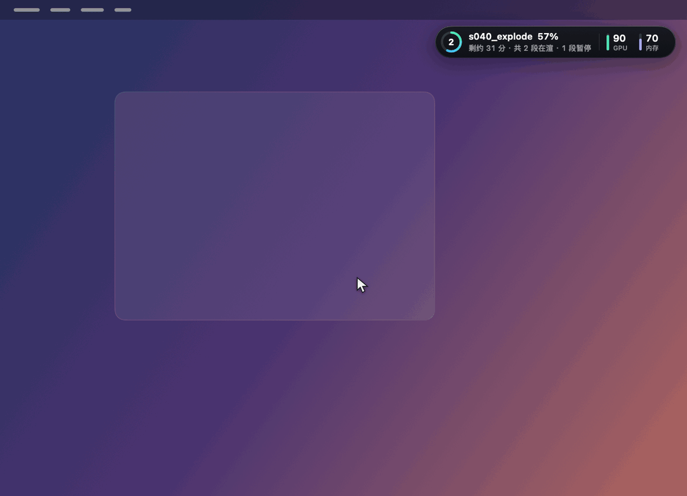
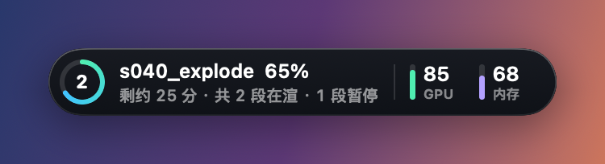
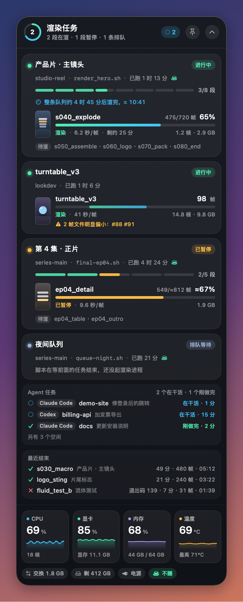

<div align="center">


# 渲染坞 RenderDock

**这台 Mac 上的每一个渲染任务，都在一个悬浮胶囊里。**

[English](../../README.md) · **简体中文** · [繁體中文](README.zh-TW.md) · [日本語](README.ja.md) · [한국어](README.ko.md) · [Español](README.es.md) · [Français](README.fr.md) · [Deutsch](README.de.md) · [Português](README.pt-BR.md) · [Русский](README.ru.md)




<sub>上面的界面由应用自己在演示模式下渲染。任务、数字和指针是编排好的，背景是示意的桌面。</sub>

</div>

---

渲染坞是一个小巧的原生 macOS 应用，给用脚本和终端起渲染的人用。它会找出这台机器上所有无界面的 Blender 任务，告诉你每个渲到哪了，同时盯着干活的硬件。不用配置，也绝不碰你的任务。

## 为什么做它

从脚本里起的渲染没有窗口。想知道进度，只能敲 `ps`、去输出目录里数文件，还要担心电脑是不是一小时前就睡了。渲染坞把这些都放在一个地方：一直在屏幕上，又不挡事。

## 你能得到什么

<table>
<tr>
<td width="50%" valign="top">

**哪儿都能待的胶囊**

拖到任意一块屏幕上都行。靠近屏幕的边、角和上下边正中会吸过去，位置会记住。它浮在全屏应用之上，切换桌面也跟着你。



**点一下，全都看得到**

- 每条任务链一张卡：标题、项目、脚本、已跑时长
- 多段任务有分段条：渲完的、在渲的、暂停的、待渲的
- 正在渲的那一段：最新一帧的缩略图、已出帧数、每帧耗时、剩余时间、占用的 CPU 核数和内存
- 能分清的状态：进行中、已暂停（`SIGSTOP`）、可能卡住、排队等待

**这台电脑，一眼看完**

CPU、显卡占用与显存、内存与内存压力、芯片温度、交换区、磁盘剩余、电源，以及有没有东西按着不让电脑睡。

</td>
<td width="50%" valign="top">



</td>
</tr>
</table>

另外还有：带进度环的菜单栏图标、可选的「渲染时保持唤醒」开关、「登录时启动」。

0.2 新增：用 [`renderdock run`](../EXACT-PROGRESS.md) 给任何渲染拿到准确进度；任务渲完、失败或卡住时，在电脑和手机上[通知](../NOTIFICATIONS.md)你；以及一个[本机接口](../API.md)，让别的显示端显示同一份进度。这三份说明目前只有英文。

0.3 新增：[历史记录](../HISTORY.md)和整条队列的剩余时间估计；[编程 agent 的会话](../AGENT-TASKS.md)和渲染任务排在一起；[ffmpeg 编码](../EXACT-PROGRESS.md#ffmpeg-from-03)的真实进度；[ComfyUI](../COMFYUI.md) 的队列。另有几样默认关闭、要你自己打开：在面板上[答复 agent 的权限请求](../ANSWERING-AGENTS.md)；[桌面上的蓝牙小屏](../DEVICES.md)，并附一块开发板的[开源固件](../../firmware/desk-display/README.md)；[给其他程序的入口](../AGENT-ENTRY.md)，任何脚本或 agent 都能发通知、报进度，或者问你一个问题；以及给 Home Assistant 用的 [MQTT](../MQTT.md)。还有两个基于本机接口的[示例](../../examples)：把灯带当进度条，和一个 Stream Deck 按键。这些说明目前只有英文。

## 快速开始

需要 macOS 14 或更高版本，以及 Swift 6 工具链（Xcode 16 以上，或者只装命令行工具：`xcode-select --install`）。

```bash
git clone https://github.com/JarnoNiu/RenderDock.git
cd RenderDock
zsh scripts/install.sh
```

这会构建应用，拷到 `/Applications/RenderDock.app` 并启动。不需要管理员密码，也不用下载任何依赖。加上 `--login` 可以顺便打开登录时启动。

手头没有渲染在跑？用虚构的任务看看它的样子：

```bash
open -n /Applications/RenderDock.app --args --demo
```

或者让它认一个真实的进程，不需要 Blender，也不占显卡：

```bash
zsh scripts/fake-render.sh 60 1
```

> 目前没有现成的安装包。应用还没有经过苹果公证，下载一个未签名的应用比花 30 秒自己构建更麻烦。签名发行版和 Homebrew 安装在路线图里。

## 它怎么认出你的渲染

渲染坞读的是进程表和输出目录。它不往 Blender 里挂任何东西，你也不用改脚本。

| 它看到 | 它显示 |
|---|---|
| 带 `-b` / `--background` 启动的 Blender 进程 | **一段** |
| 进程树上最外层的脚本（`zsh render_all.sh`、`python queue.py` 等） | **一条任务链**，对应一张卡。标题取脚本的第一行注释 |
| 排队脚本命令行里的 `scene:shot` 参数 | **队列**：哪些段渲完了、在渲、待渲 |
| 用 `caffeinate` 包着、还没有渲染进程的脚本 | **排队等待** |
| 被 `kill -STOP` 挂起的进程 | **已暂停** |
| 超过平时每帧耗时的 10 倍（至少 5 分钟）没出新帧 | **可能卡住** |
| 输出目录里的图片文件，按帧号去重 | **已出帧数**、每帧耗时、最新一帧的缩略图 |

输出目录取自 Blender 自己的 `-o` / `--render-output`（包括相对 `.blend` 的 `//` 写法），或者脚本在 `--` 之后的参数 `--out 目录`。你自己流水线里不是普通 Blender 渲染的步骤，可以用一个小的[规则文件](../ADAPTERS.md)来描述。

### 百分比从哪来

只有知道总帧数，渲染坞才显示百分比。它不猜。

| 来源 | 显示成 |
|---|---|
| 输出目录里的 `render-progress.json`（见下） | 准数：`412/720 帧 · 57%`，外加剩余时间 |
| 命令行里写了帧范围：`-s 1 -e 250 -a`，或 `-f 1..250` | 准数 |
| 用 `renderdock run --` 启动，或加载了 Blender 钩子 | 准数，哪怕命令行里什么都没写。还能分清任务是渲完了还是失败了 |
| 输出目录旁边有同名的旧片段 | 估算，标 `≈`。已出帧数一超过它，估算就撤掉 |
| 以上都没有 | 只显示帧数和每帧耗时，进度条走流动光带 |

```bash
# 不用任何配置就有准确进度
blender -b shot_010.blend -o //render/frame_#### -s 1 -e 250 -a
```

### `render-progress.json`：任何流程都能报准确进度

如果帧范围存在 `.blend` 里，或者你的脚本自己逐帧渲，每渲完一帧往输出目录写一个小文件就行：

```json
{"done": 12, "total": 720}
```

```python
# 在 Blender 的 Python 脚本里
(out_dir / "render-progress.json").write_text(json.dumps({"done": i + 1, "total": len(frames)}))
```

能写文件的东西都能这样报进度，不限于 Blender。

## 它不做什么

- 它**绝不碰你的渲染**：不给它们发信号，也绝不往你的渲染目录里写东西。凡是超出「看」的功能都默认关闭，要你自己打开：通知渠道、本机接口（只监听 `127.0.0.1`）、连接桌面小屏的蓝牙、答复 agent 的请求、给其他程序的入口、MQTT。除非你自己添加了通知渠道或 MQTT 服务器，否则它不联网。
- 目前还没有暂停、继续、终止按钮。排队脚本常常自己在用 `STOP`／`CONT` 调度，两只手按同一个开关不是好主意。
- 如果输出目录和帧范围都不在命令行里，任务照样会出现，有 CPU、内存和已跑时长，但没有帧数。
- 芯片温度读的是 IOHID 传感器，这是 Apple 芯片上的私有接口。在 Intel Mac 上，或者系统更新挪了传感器之后，这一格显示 `–`。风扇转速和功耗没有读。
- 在 macOS 26 和 M5 Max 上构建并测试。它能按 macOS 14 编译，但 14、15 和 Intel Mac 都没测过，欢迎反馈。
- 界面语言：英文和简体中文（跟随系统语言；用 `--lang en` 或 `--lang zh` 强制指定）。

## 路线图

带时间线的完整待办清单见 **[路线图](ROADMAP.zh-CN.md)**。

简单说（是计划，不是承诺）：

- 从网络上访问：带令牌的局域网接口，桌面小屏走 Wi-Fi
- 更多渲染器各自的真实进度
- 可选的控制：暂停、继续、降低优先级
- 签名并公证的发行版、Homebrew、更多界面语言

## 开发

| 命令 | 作用 |
|---|---|
| `zsh scripts/build-app.sh` | 构建 `build/RenderDock.app`（本机临时签名；图标由应用自己画） |
| `zsh scripts/install.sh [--login]` | 构建、装到 `/Applications`、重新启动 |
| `swift run rd-checks` | 核心部分的检查：解析、事件、接口、通知、agent、设备协议（534 项） |
| `.build/release/RenderDock --dump` | 不开界面，把认出的任务和指标打印成文字 |
| `.build/release/RenderDock --snapshot 目录 [--demo]` | 把胶囊和面板渲成 PNG |
| `zsh scripts/make-demo.sh` | 重新生成 `assets/` 里的截图和动图 |
| `zsh scripts/fake-render.sh [帧数] [每帧秒数]` | 用来测试识别的假渲染 |
| `python3 scripts/verify-interactions.py <可执行文件>` | 给带 `--debug` 启动的实例注入点击和拖动，检查展开、收起和吸附（12 项） |

代码是纯 Swift 和 SwiftUI，窗口部分用 AppKit：约 9,000 行，不依赖任何包。见 [CONTRIBUTING.md](../../CONTRIBUTING.md)。

## 致谢

渲染坞没有使用下面这些项目的代码，但它们证明了不用 `sudo` 能做到什么：[Stats](https://github.com/exelban/stats) 和 [macmon](https://github.com/vladkens/macmon)（读取显卡与传感器数据），以及 [boring.notch](https://github.com/TheBoredTeam/boring.notch)（让一直在场的小界面在 Mac 上显得自然）。

目标相近的项目：[Blender Render Monitor](https://github.com/DUBSON0/blender-render-monitor) 同样列出 Mac 上的 Blender 渲染，并且已经有暂停、继续和队列。它靠 Blender 钩子脚本或日志文件拿进度。渲染坞 0.1 写完之后才发现它，两者没有共用代码。

## 许可证

[MIT](../../LICENSE)
