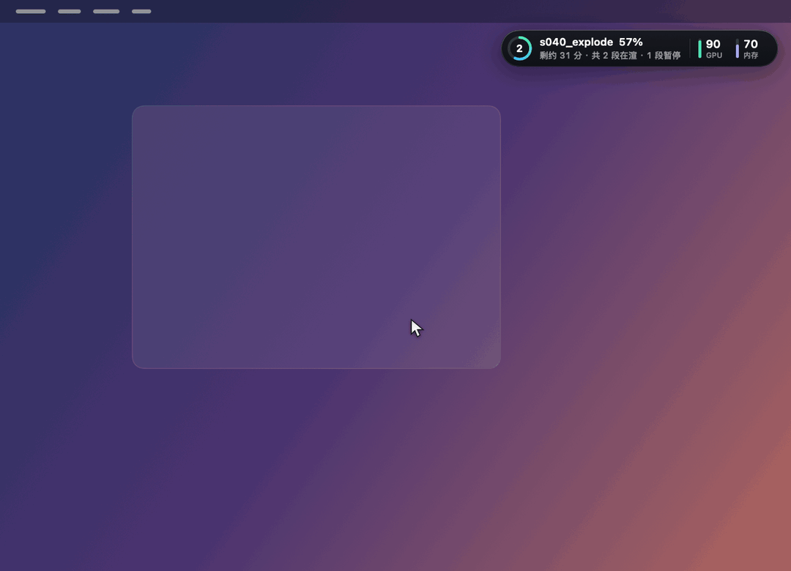
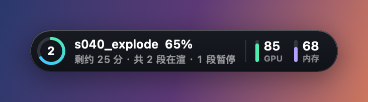
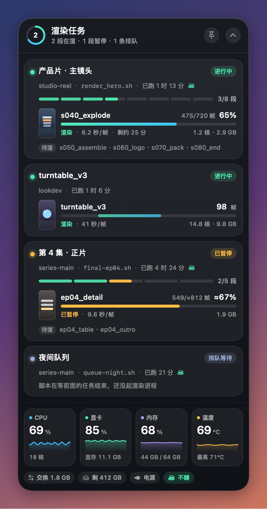

<div align="center">


# 渲染塢 RenderDock

**這台 Mac 上的每一個渲染任務，都收在一個懸浮膠囊裡。**

[English](../../README.md) · [简体中文](README.zh-CN.md) · **繁體中文** · [日本語](README.ja.md) · [한국어](README.ko.md) · [Español](README.es.md) · [Français](README.fr.md) · [Deutsch](README.de.md) · [Português](README.pt-BR.md) · [Русский](README.ru.md)




<sub>上方的介面是應用程式自己在示範模式下繪製的。任務、數字和游標都是事先編排好的，背景是模擬的桌面。<br>介面目前只提供英文和簡體中文，所以截圖是簡體中文介面。</sub>

</div>

---

渲染塢是一款小巧的 macOS 原生應用程式，給用腳本和終端機啟動渲染的人用。它會找出這台機器上所有無介面的 Blender 任務，顯示每個任務的進度，同時留意負責運算的硬體。不需要任何設定，也絕對不會動到你的任務。

## 為什麼做這個

從 shell 腳本啟動的渲染沒有視窗。到頭來只能執行 `ps`、去輸出資料夾裡數檔案，還得猜 Mac 是不是一小時前就進入睡眠了。渲染塢把這些全都放在同一個地方：一直在螢幕上，又不礙事。

## 你會得到什麼

<table>
<tr>
<td width="50%" valign="top">

**放哪裡都行的膠囊**

可以拖到任何一台顯示器上。它會吸附到螢幕的邊緣、角落，以及上下邊緣的正中央，並記住你上次放的位置。它會浮在全螢幕應用程式上方，切換 Spaces 時也跟著你走。



**點一下，就能看到全貌**

- 每條任務鏈一張卡片：標題、專案、腳本、已執行時間
- 多段任務有分段進度條：已完成、渲染中、已暫停、待渲染
- 正在渲染的那一段：最新影格的縮圖、已完成影格數、每影格秒數、剩餘時間、使用的 CPU 核心數和記憶體
- 能分辨的狀態：進行中、已暫停（`SIGSTOP`）、可能卡住、排隊等待

**這台電腦的狀況，一眼看完**

CPU、顯示卡使用率與顯示記憶體、記憶體與記憶體壓力、晶片溫度、置換空間（swap）、磁碟剩餘空間、電源，以及是否有程式讓 Mac 保持喚醒。

</td>
<td width="50%" valign="top">



</td>
</tr>
</table>

另外還有：帶進度環的選單列圖示、可選的「渲染時保持喚醒」開關，以及「登入時啟動」。

## 快速開始

需求：macOS 14 或以上版本，以及 Swift 6 工具鏈（Xcode 16 以上，或只安裝命令列工具：`xcode-select --install`）。

```bash
git clone https://github.com/JarnoNiu/RenderDock.git
cd RenderDock
zsh scripts/install.sh
```

這會建置應用程式，複製到 `/Applications/RenderDock.app` 並啟動。不需要管理員密碼，也不必下載任何相依套件。加上 `--login` 可以一併開啟「登入時啟動」。

手邊沒有渲染在跑？用虛構的任務看看它的樣子：

```bash
open -n /Applications/RenderDock.app --args --demo
```

或者看它辨識出一個真實的行程，不需要 Blender，也用不到顯示卡：

```bash
zsh scripts/fake-render.sh 60 1
```

> 目前還沒有預先建置好的下載檔。應用程式尚未經過 Apple 公證，而下載未簽署的版本比花 30 秒自己建置還麻煩。已簽署的發行版本和 Homebrew cask 都列在發展藍圖裡。

## 它怎麼找到你的渲染

渲染塢讀取的是系統的行程清單和輸出資料夾。它不會掛進 Blender，你也不需要修改腳本。

| 它看到 | 它顯示 |
|---|---|
| 以 `-b` / `--background` 啟動的 Blender 行程 | **一段** |
| 行程樹中位於它上方、最外層的腳本（`zsh render_all.sh`、`python queue.py` 等） | **一條任務鏈**，對應一張卡片。標題取自該腳本的第一行註解 |
| 佇列腳本命令列上的 `scene:shot` 參數 | **佇列**：哪些段已完成、渲染中、待渲染 |
| 用 `caffeinate` 包住、但還沒有渲染行程的腳本 | **排隊等待** |
| 被 `kill -STOP` 停住的行程 | **已暫停** |
| 超過平常每影格耗時的 10 倍（至少 5 分鐘）沒有新影格 | **可能卡住** |
| 輸出資料夾裡的圖片檔，依影格編號去除重複 | **已完成影格數**、每影格秒數、最新影格的縮圖 |

輸出資料夾取自 Blender 本身的 `-o` / `--render-output`（包含相對於 `.blend` 的 `//` 路徑），或是腳本在 `--` 之後的參數 `--out 資料夾`。

### 百分比從哪裡來

渲染塢只有在知道總數時才會顯示百分比。它不會用猜的。

| 來源 | 顯示為 |
|---|---|
| 輸出資料夾裡的 `render-progress.json`（見下文） | 精確值：`412/720 影格 · 57%`，以及剩餘時間 |
| 命令列上的影格範圍：`-s 1 -e 250 -a`，或 `-f 1..250` | 精確值 |
| 輸出資料夾旁有同名的舊影片片段 | 估計值，標示 `≈`。已完成影格數一超過它，就不再採用 |
| 以上皆無 | 只顯示影格數和每影格秒數，進度條只有流動光帶，不表示具體進度 |

```bash
# 不需任何設定就有精確進度
blender -b shot_010.blend -o //render/frame_#### -s 1 -e 250 -a
```

### `render-progress.json`：任何流程都能回報精確進度

如果影格範圍存在 `.blend` 裡，或是你的腳本自己逐格渲染，就在每個影格完成後往輸出資料夾寫入一個小檔案：

```json
{"done": 12, "total": 720}
```

```python
# 在 Blender 的 Python 腳本裡
(out_dir / "render-progress.json").write_text(json.dumps({"done": i + 1, "total": len(frames)}))
```

只要能寫檔案，都可以用這種方式回報進度，不限於 Blender。

## 它不做什麼

- 它是**唯讀**的：不發送任何訊號，不在自己的偏好設定之外寫入任何東西，也不建立任何網路連線。
- 0.1 版沒有暫停、繼續或停止按鈕。佇列腳本往往自己在管理 `STOP`／`CONT`，兩隻手去按同一個開關不是好主意。
- 如果輸出資料夾和影格範圍都不在命令列上，任務還是會出現，並顯示 CPU、記憶體和已執行時間，但沒有影格資訊。
- 晶片溫度讀自 IOHID 感測器，這是 Apple 晶片上才有的私有介面。在 Intel Mac 上，或是系統更新調動了感測器之後，這一格會顯示 `–`。不讀取風扇轉速和功耗。
- 在 macOS 26 和 M5 Max 上建置並測試。它可以針對 macOS 14 編譯，但 14、15 和 Intel Mac 都沒有測試過。歡迎回報。
- 介面語言：英文和簡體中文（跟隨系統語言；可用 `--lang en` 或 `--lang zh` 強制指定）。

## 發展藍圖

附時間表的完整待辦清單請見 **[發展藍圖](ROADMAP.zh-CN.md)**（簡體中文）。

簡單來說（是計畫，不是承諾）：

- 開箱即有精確進度：用包裝程式（wrapper）或附加元件讀取 Blender 自己輸出的影格資訊
- 不只 Blender：ffmpeg 編碼、ComfyUI、After Effects，以及給其他工具用的小型轉接格式
- 任務完成、卡住或失敗時發出通知，Mac 和手機上都收得到
- 本機 API：讓桌上的小螢幕、狀態燈或 Stream Deck 按鍵都能顯示同一份進度
- 歷史紀錄：每一段實際花了多久，並據此把剩餘時間估得更準
- 可選的控制功能：暫停、繼續、降低優先權
- 已簽署並經公證的發行版本、Homebrew、更多介面語言

## 開發

| 指令 | 作用 |
|---|---|
| `zsh scripts/build-app.sh` | 建置 `build/RenderDock.app`（ad-hoc 簽署；圖示由應用程式自己繪製） |
| `zsh scripts/install.sh [--login]` | 建置、安裝到 `/Applications`、重新啟動 |
| `.build/release/RenderDock --dump` | 以文字印出偵測到的任務和指標，不顯示介面 |
| `.build/release/RenderDock --snapshot 資料夾 [--demo]` | 把膠囊和面板繪製成 PNG |
| `zsh scripts/make-demo.sh` | 重新產生 `assets/` 裡的截圖和 GIF |
| `zsh scripts/fake-render.sh [影格數] [每影格秒數]` | 用來測試偵測功能的假渲染 |
| `python3 scripts/verify-interactions.py <執行檔>` | 對以 `--debug` 啟動的程式注入點擊和拖曳，檢查展開、收合和吸附（12 項檢查） |

程式碼是單純的 Swift 和 SwiftUI，視窗部分使用 AppKit：約 3,000 行，沒有用任何套件。請參閱 [CONTRIBUTING.md](../../CONTRIBUTING.md)。

## 致謝

渲染塢沒有使用以下專案的程式碼，但它們展示了不靠 `sudo` 能做到什麼：[Stats](https://github.com/exelban/stats) 和 [macmon](https://github.com/vladkens/macmon)（讀取顯示卡與感測器資料），以及 [boring.notch](https://github.com/TheBoredTeam/boring.notch)（讓隨時都在的小介面在 Mac 上顯得自然）。

目標相近的專案：[Blender Render Monitor](https://github.com/DUBSON0/blender-render-monitor) 同樣會列出 Mac 上的 Blender 渲染，而且已經有暫停、繼續和佇列功能。它透過 Blender 的 hook 腳本或記錄檔取得進度。渲染塢 0.1 是在不知道它存在的情況下寫成的，兩者沒有共用任何程式碼。

## 授權條款

[MIT](../../LICENSE)
